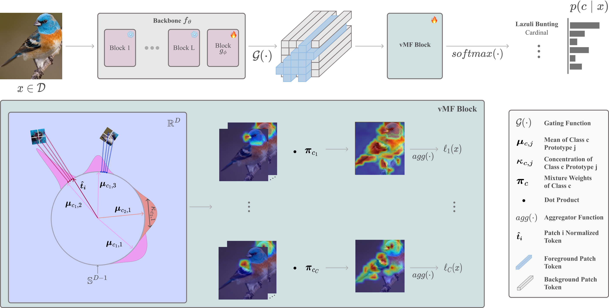
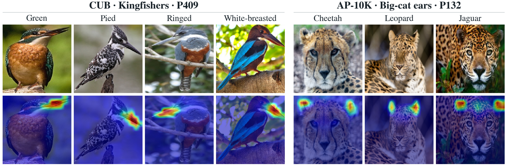
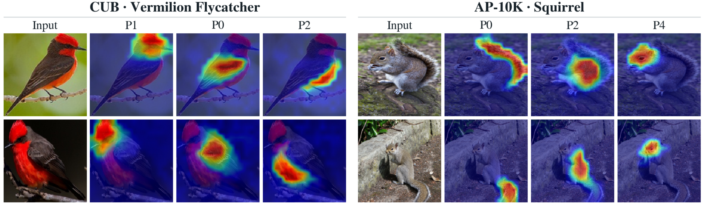
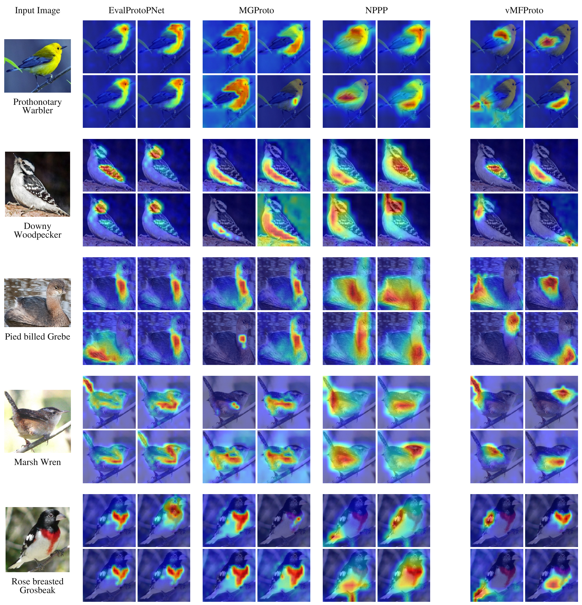
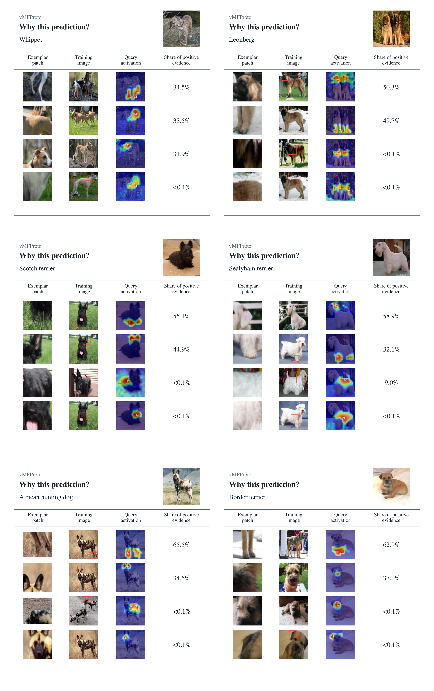

<div align="center">

# vMFProto

### Beyond Points: Spherical Distributional Part Prototypes for Interpretable Classification

Duarte Leão · Diogo Pereira Araújo · Catarina Barata · Carlos Santiago

[](https://arxiv.org/abs/2606.27582)
[](https://duarte-leao.github.io/vMF-Proto_page/)


**Distributional part prototypes · Class-specific banks and shared pools · DINOv2 and DINOv3**

</div>

vMFProto matches image patches to von Mises–Fisher distributions on the unit
sphere. Each prototype describes a representative feature direction and the
variation around it, providing part-level evidence for fine-grained classification.

<details open>
<summary><b>Architecture at a glance</b></summary>



A frozen vision transformer and a trainable block extract patch features.
The foreground gate selects patches, and distributional prototypes provide
part-level evidence for classification.

</details>

## Contents

- [Quickstart](#quickstart)
- [1. Installation](#1-installation)
- [2. Backbone code and pretrained weights](#2-backbone-code-and-pretrained-weights)
- [3. Download and prepare datasets](#3-download-and-prepare-datasets)
- [4. Train, resume, and manage checkpoints](#4-train-resume-and-manage-checkpoints)
- [5. Evaluate a checkpoint](#5-evaluate-a-checkpoint)
- [6. Visualize prototypes](#6-visualize-prototypes)
- [7. Tests and smoke runs](#7-tests-and-smoke-runs)
- [8. Configuration and troubleshooting](#8-configuration-and-troubleshooting)
- [Training recipe](#training-recipe)
- [Figures from the paper](#figures-from-the-paper)
- [Repository map](#repository-map)
- [Citation and acknowledgments](#citation-and-acknowledgments)

---

## Quickstart

The shortest path is a **class-specific CUB run with DINOv2 ViT-B/14 and five
prototypes per class**. First complete [installation](#1-installation), clone the
[backbone code](#2-backbone-code-and-pretrained-weights), and download
[CUB-200-2011](#cub-200-2011).

Run these commands from the repository root:

```bash
# 1. Point to the parent of the CUB_200_2011 directory.
export DATA_ROOT="/absolute/path/to/datasets"

# 2. Prepare cropped train/test folders. Skip if already prepared.
python scripts/preprocess/cropimages.py --data-root "$DATA_ROOT"

# 3. Train the default 25-epoch class-specific model.
python scripts/train.py \
  dataset.root="$DATA_ROOT" \
  run.name=cub_specific \
  train.device=cuda:0

# 4. Replace this with the run directory created above.
export RUN_DIR="/absolute/path/to/vMF-Proto/runs/YYYYMMDD/cub_specific_RUNID"

# 5. Evaluate the final checkpoint.
python scripts/eval.py eval.run_dir="$RUN_DIR" eval.checkpoint_alias=last

# 6. Render four prototype maps for five test images.
python scripts/visualize_prototypes.py \
  --ckpt "$RUN_DIR/checkpoints/last.pth" \
  --data-dir "$DATA_ROOT" --focus gt --topk 4 --num-samples 5 \
  --out-dir outputs/cub_specific_gallery
```

**Before a full run:** the frozen-prefix caches require substantial host RAM and
disk space. We recommend the [short smoke run](#gpu-smoke-run) first. For shared
prototypes, use `model=vmf_shared`; complete examples follow below.

## 1. Installation

### Clone the repository and create an environment

```bash
git clone https://github.com/Duarte-leao/vMF-Proto.git
cd vMF-Proto

python3.11 -m venv .venv
source .venv/bin/activate
python -m pip install --upgrade pip
python -m pip install -r requirements.txt \
  --extra-index-url https://download.pytorch.org/whl/cu121
```

The tested environment uses **Python 3.11, PyTorch 2.3.1, torchvision 0.18.1,
and CUDA 12.1**. The supplied requirements pin that CUDA build. If you need a
different build, use the corresponding PyTorch/torchvision pair from the
[official PyTorch installation archive](https://pytorch.org/get-started/previous-versions/)
and adjust those requirements consistently.

For tests, also install the development requirements:

```bash
python -m pip install -r requirements-dev.txt \
  --extra-index-url https://download.pytorch.org/whl/cu121
```

No experiment-tracking account is required. The four-loss learner writes local
logs and history; it does not initialize Weights & Biases.

### Check your environment

```bash
python -c "import torch; print('PyTorch:', torch.__version__); print('CUDA available:', torch.cuda.is_available())"
```

Unit tests can run on CPU. Full training is intended for a CUDA-capable GPU.

## 2. Backbone code and pretrained weights

### Download the DINO source trees

Clone both official repositories inside `vMF-Proto/` and check out the pinned
commits. Both source trees are currently imported by the backbone wrapper, even
when training with only one backbone family.

```bash
git clone https://github.com/facebookresearch/dinov2.git dinov2
git -C dinov2 checkout e1277af2ba9496fbadf7aec6eba56e8d882d1e35

git clone https://github.com/facebookresearch/dinov3.git dinov3
git -C dinov3 checkout 54694f7627fd815f62a5dcc82944ffa6153bbb76
```

You do not need to install these repositories with `pip install -e`. If you
already have the clones elsewhere, point to their roots instead:

```bash
export DINOV2_SOURCE="/absolute/path/to/dinov2"
export DINOV3_SOURCE="/absolute/path/to/dinov3"
```

### Choose a supported backbone

| Backbone | Configuration value | Pretrained weights |
| --- | --- | --- |
| DINOv2 ViT-S/14 with registers | `dinov2_vits14` | [Official checkpoint](https://dl.fbaipublicfiles.com/dinov2/dinov2_vits14/dinov2_vits14_reg4_pretrain.pth) |
| DINOv2 ViT-B/14 with registers | `dinov2_vitb14` | [Official checkpoint](https://dl.fbaipublicfiles.com/dinov2/dinov2_vitb14/dinov2_vitb14_reg4_pretrain.pth) |
| DINOv3 ViT-S/16 | `dinov3_vits16` | [Request access from Meta](https://ai.meta.com/resources/models-and-libraries/dinov3-downloads/) |
| DINOv3 ViT-B/16 | `dinov3_vitb16` | [Request access from Meta](https://ai.meta.com/resources/models-and-libraries/dinov3-downloads/) |

See the official [DINOv2 repository](https://github.com/facebookresearch/dinov2)
and [DINOv3 pretrained-model instructions](https://github.com/facebookresearch/dinov3#pretrained-models)
for model information and access terms.

**DINOv2:** weights download automatically into the torch hub cache on first use.
The implementation expects the **register-token checkpoints** linked above.

**DINOv3:** request access, download the matching LVD-1689M backbone checkpoint,
and set its local path before training, evaluation, or visualization:

```bash
export VMF_BACKBONE_WEIGHTS="/absolute/path/to/dinov3_vitb16_pretrain_lvd1689m-73cec8be.pth"

python scripts/train.py \
  dataset.root="$DATA_ROOT" \
  model.backbone=dinov3_vitb16 \
  run.name=cub_dinov3b
```

`VMF_BACKBONE_WEIGHTS` also accepts local DINOv2 weights. **Unset it when switching
to a different model**, otherwise the wrapper will try to load the wrong file:

```bash
unset VMF_BACKBONE_WEIGHTS
```

Signed download URLs and pretrained weights are not bundled. The wrapper also
disables optional xFormers attention so the foreground gate can collect explicit
attention probabilities. Keep `model.num_splits=1` for this fitting recipe.

## 3. Download and prepare datasets

### Download links

| Dataset | Source and download | Configuration |
| --- | --- | --- |
| CUB-200-2011 | [Official dataset page](https://www.vision.caltech.edu/datasets/cub_200_2011/) · [Images and annotations](https://data.caltech.edu/records/65de6-vp158) | `dataset=cub200` |
| AP-10K | [Official repository](https://github.com/AlexTheBad/AP-10K) · [Download instructions](https://github.com/AlexTheBad/AP-10K#download) · [Author-linked labeled archive](https://drive.google.com/file/d/1-FNNGcdtAQRehYYkGY1y4wzFNg4iWNad/view) | `dataset=ap10k` |
| Stanford Dogs | [Official dataset page](https://vision.stanford.edu/aditya86/ImageNetDogs/main.html) · [Images](https://vision.stanford.edu/aditya86/ImageNetDogs/images.tar) · [Train/test lists](https://vision.stanford.edu/aditya86/ImageNetDogs/lists.tar) | `dataset=stanford_dogs` |
| Stanford Cars | [Dataset information and hosting status](https://docs.pytorch.org/vision/stable/generated/torchvision.datasets.StanfordCars.html) · [Community mirror](https://huggingface.co/datasets/tanganke/stanford_cars) | `dataset=stanford_cars` |

The original Stanford Cars download is no longer available. The linked mirror
is community-maintained, not an official replacement. Preserve the official
train/test split and labels when preparing its ImageFolder directories.
Datasets are downloaded separately and remain subject to their providers' terms.

### CUB-200-2011

Set `DATA_ROOT` to the **parent** of `CUB_200_2011/`, not the `images/` directory:

```bash
export DATA_ROOT="/absolute/path/to/datasets"
```

```text
DATA_ROOT/
├── CUB_200_2011/
│   ├── images/<class>/<image>.jpg
│   ├── images.txt
│   ├── classes.txt
│   ├── image_class_labels.txt
│   ├── bounding_boxes.txt
│   ├── train_test_split.txt
│   └── parts/
│       ├── parts.txt
│       └── part_locs.txt
└── cub200_cropped/                         # created by preprocessing
    ├── train_cropped/<class>/<image>.jpg
    └── test_cropped/<class>/<image>.jpg
```

From the **uncropped CUB-200-2011 archive**, create the training and test crops:

```bash
python scripts/preprocess/cropimages.py --data-root "$DATA_ROOT"
```

The cropper writes the prepared splits without modifying the original images.
If your original images are already cropped, reuse the prepared splits or
restore the uncropped images before running this step again.
Part landmarks are needed for explanation evaluation, not prototype training.
Segmentation masks are not required by the four-loss evaluation path.

<details>
<summary><b>Optional: offline augmentation</b></summary>

The default fitted configuration uses `train_cropped/` without offline
augmentation. To explicitly use the existing augmentation utility:

```bash
python scripts/preprocess/img_aug.py --data-root "$DATA_ROOT" --passes 15

python scripts/train.py \
  dataset.root="$DATA_ROOT" \
  dataset.train_dir=train_cropped_augmented \
  run.name=cub_augmented
```

This creates an additional training directory and increases data/cache size.
Use `dataset.train_dir=train_cropped` to switch back to the default folder.

</details>

### AP-10K

Download the **labeled archive** linked by the authors. Set `AP10K_ROOT` to the
extracted directory containing `data/` and `annotations/`:

```bash
export AP10K_ROOT="/absolute/path/to/ap-10k"
```

```text
AP10K_ROOT/
├── data/<image>.jpg
└── annotations/
    ├── ap10k-train-split1.json
    ├── ap10k-val-split1.json
    └── ap10k-test-split1.json
```

All three annotation files for the selected official split are required. Use
`dataset.split_id=2` or `3` for another official split, and override
`dataset.images_dir` or `dataset.annotation_dir` if your archive differs.

Inputs are **full images**, not animal-box crops. The loader maps species IDs
consistently, rejects ambiguous multi-species images and cross-split duplicates,
and returns no keypoints or boxes to the learner. The provided config expects
**50 represented classes**, matching the archive indexed for our runs. If your
archive has a different represented vocabulary, set `dataset.num_classes` to
the count reported by the loader.

### Stanford Dogs

The default Dogs configuration expects this layout beneath `DATA_ROOT`:

```text
DATA_ROOT/
└── stanford_dogs/
    ├── Images/<breed>/<image>.jpg
    └── train_test_split/
        ├── train_list.mat
        └── test_list.mat
```

Extract the official images and place the official split lists in
`train_test_split/`. No cropping or augmentation step is required here.

```bash
python scripts/train.py dataset=stanford_dogs dataset.root="$DATA_ROOT" run.name=dogs_specific
```

If your root directly contains `Images/` and `train_test_split/`, override
`dataset.images_dir=Images` and `dataset.split_dir=train_test_split`.

### Stanford Cars

Prepare the official classification split as class folders. The loader reads
ImageFolder directories; it does not convert raw MAT annotations or a mirror's
storage format automatically.

```text
DATA_ROOT/
└── stanford_cars/
    ├── train/<class>/<image>.jpg
    └── test/<class>/<image>.jpg
```

Use the same class-folder vocabulary in both splits. Then train with:

```bash
python scripts/train.py dataset=stanford_cars dataset.root="$DATA_ROOT" run.name=cars_specific
```

For a root directly containing `train/` and `test/`, override
`dataset.train_dir=train` and `dataset.test_dir=test`.

**Dogs and Cars:** request accuracy-only evaluation. CUB/AP-10K part metrics are
not applicable to these datasets.

## 4. Train, resume, and manage checkpoints

### Class-specific prototypes

```bash
# CUB: DINOv2-B, five prototypes per class.
python scripts/train.py \
  dataset.root="$DATA_ROOT" run.name=cub_specific train.device=cuda:0

# AP-10K: monitor its official validation split.
python scripts/train.py \
  dataset=ap10k dataset.root="$AP10K_ROOT" \
  train.fitting.monitor_split=val run.name=ap10k_specific
```

Change the per-class budget with `model.num_prototypes=7`. The backbone is
selected with `model.backbone`; see the [supported models](#choose-a-supported-backbone).

### Shared prototype pools

```bash
# CUB: one pool of 1,000 foreground prototypes.
python scripts/train.py \
  model=vmf_shared dataset.root="$DATA_ROOT" \
  model.shared_prototypes=1000 run.name=cub_shared

# AP-10K: one pool of 250 foreground prototypes.
python scripts/train.py \
  dataset=ap10k model=vmf_shared dataset.root="$AP10K_ROOT" \
  model.shared_prototypes=250 train.fitting.monitor_split=val \
  run.name=ap10k_shared
```

Use `model.shared_prototypes=512` for the smaller CUB pool or `125` for AP-10K.
The implementation requires a shared budget between 2 and `C × J`, where `C`
is the number of classes and `J=model.num_prototypes`.

### Understand the run directory

```text
runs/YYYYMMDD/<run_name>_<shortid>/
├── config.yaml                            # resolved training configuration
├── train.log                              # per-update losses and phase information
├── history.jsonl                          # per-epoch monitor accuracy/refit status
├── cache/
│   ├── train.pt                           # frozen clean/noisy training prefixes
│   └── test.pt or val.pt                   # frozen monitor prefixes
└── checkpoints/
    ├── last.pth                           # latest completed epoch
    └── best.pth                           # highest monitor accuracy so far
```

Checkpoints include the fitted inference parameters, free training parameters,
optimizer, same-run references, configuration, and RNG state.

### Resume from the saved configuration

Set `RUN_DIR` to an **absolute path**. Loading its resolved config avoids having
to repeat every model, dataset, and loss override:

```bash
export RUN_DIR="/absolute/path/to/your/run"

python scripts/train.py \
  --config-path "$RUN_DIR" --config-name config \
  run.resume_dir="$RUN_DIR"
```

Resume continues after the last completed epoch, rather than restarting from
the fitted inference bank alone. Keep the data and training configuration
unchanged: the loader checks configuration and input-file metadata before
reusing cached prefixes. Load only checkpoints you trust.
Changes to discovery losses or fitting settings require a new run.

### Memory and storage

Frozen-prefix caching saves repeated DINO computation but requires **substantial
host RAM and tens of GB of disk space** for full datasets, especially while
initially assembling clean and noisy views. Cache construction precedes the
epoch logs and can take time.

If GPU memory is tight, start with:

```bash
python scripts/train.py dataset.root="$DATA_ROOT" \
  train.fitting.micro_batch_size=4 \
  train.fitting.support_microbatch=8 \
  eval.batch_size=8 train.num_workers=2
```

These microbatch controls retain the full fitting support. Reducing
`train.batch_size` also changes the query/support partition, so try the
microbatch settings first. Do not delete a run's caches while it is training.

## 5. Evaluate a checkpoint

The default evaluation loads **`last.pth`** and the model/dataset configuration
saved with it:

```bash
python scripts/eval.py \
  eval.run_dir="$RUN_DIR" eval.checkpoint_alias=last train.device=cuda:0
```

Common variations:

```bash
# Evaluate the monitor-selected checkpoint instead.
python scripts/eval.py eval.run_dir="$RUN_DIR" eval.checkpoint_alias=best

# Evaluate AP-10K's validation split rather than the default test split.
python scripts/eval.py eval.run_dir="$RUN_DIR" eval.split=val

# Override the dataset root after moving a run to another machine.
python scripts/eval.py eval.run_dir="$RUN_DIR" eval.data_root="$DATA_ROOT"

# Dogs / Cars: accuracy only.
python scripts/eval.py eval.run_dir="$RUN_DIR" 'eval.metrics=[accuracy]'
```

Results are printed and saved as `eval_<checkpoint>_<split>.json` in the run
directory. Accuracy and explanation scores are percentages.

| Metric | What is evaluated |
| --- | --- |
| Accuracy | Top-1 classification on the requested split |
| Consistency | Whether each class/prototype pair repeatedly matches a part, using an 80% visible-part threshold |
| Stability | Agreement of the complete part-hit sets under bounded Gaussian noise |
| Distinctiveness | Spatial separation of prototype responses using the peak-box IoU protocol |

Class-specific explanations use the class's bank. Shared explanations use its
**five highest-weighted prototypes** by default; change this with `eval.topk=10`.
Part maps are evaluated without the foreground gate. Distinctiveness retains
the 2×2 average-pool, bilinear-resize, 72-pixel peak-box procedure.

### AP-10K explanation annotations

With only the official archive, consistency/stability use visible keypoints
with left/right counterparts merged. The JSON report explicitly calls this a
**keypoint-only diagnostic**, not the coarse-mask protocol.

For coarse-region evaluation, provide an external, evaluation-only NPZ pack:

| Array | Shape | Contents |
| --- | --- | --- |
| `image_ids` | `[N]` | Official AP-10K image IDs |
| `group_names` | `[G]` | Region names stored as strings, without Python objects |
| `masks` | `[N, G, H, W]` | Boolean masks aligned to full-image coordinates |

```bash
python scripts/eval.py eval.run_dir="$RUN_DIR" \
  eval.ap10k_regions="/absolute/path/to/evaluation_regions.npz"
```

Every evaluated image must be present in the pack. Mask/window intersections
define the non-leg hits; a group named `legs` instead uses visible leg
keypoints. This repository does not bundle or generate SAM masks, and the
region pack never enters training.

## 6. Visualize prototypes

Generate clean input-plus-heatmap panels for either fitted model variant:

```bash
python scripts/visualize_prototypes.py \
  --ckpt "$RUN_DIR/checkpoints/last.pth" \
  --data-dir "$DATA_ROOT" --dataset auto --split test --device cuda:0 \
  --focus gt --topk 4 --num-samples 5 \
  --out-dir outputs/prototype_gallery
```

For AP-10K, use `--data-dir "$AP10K_ROOT"`. The checkpoint identifies the model
variant and dataset; a separate shared-model visualization script is not needed.

| Option | Use |
| --- | --- |
| `--focus gt` / `--focus pred` | Explain the ground-truth / predicted class |
| `--indices 10 20` | Choose specific dataset rows |
| `--class-id 5 --per-class 2` | Restrict the class and number of examples |
| `--topk 4` | Set the displayed foreground-prototype count |
| `--display-temperature 400` | Set display sharpness, independently of inference |
| `--fg-gate` | Explicitly gate the displayed maps; omitted by default |
| `--dpi 200` | Increase exported figure resolution |

The fitted path uses **spatial softmax of `T × cosine similarity`**, followed by
per-map maximum scaling for display. Larger `T` makes the map sharper. This
does not change the model, checkpoint, or classification scores.

Default display settings are T=650 for class-specific models, T=400 for shared
CUB, and T=175 for shared AP-10K. Maps are **ungated** unless `--fg-gate` is set.

```text
outputs/prototype_gallery/
├── 000010.png
├── 000020.png
└── gallery.json                           # inputs, prototype IDs, normalization, T
```

Use the gallery options above; explicit prototype-ID and background-prototype
displays are not supported.

<details>
<summary><b>Optional: inspect CUB foreground masks before training</b></summary>

This existing utility inspects backbone-derived masks without loading a fitted
checkpoint:

```bash
python scripts/debug_foreground.py \
  --output-dir outputs/foreground_debug --data-root "$DATA_ROOT" \
  --dataset cub200 --backbone dinov2_vitb14 --num-splits 1 \
  --fg-method attn_pca_refine --attn-threshold 0.01 --pca-threshold 0.5 \
  --limit 8 --device cuda:0
```

This command is for CUB; the utility's dataset choices do not include AP-10K.

</details>

## 7. Tests and smoke runs

### CPU unit tests

After installing the development requirements:

```bash
OMP_NUM_THREADS=2 python -m pytest tests -q
```

These tests require **no dataset, DINO source trees, weight downloads, or GPU**.
They cover both variants, the exponential readout, the exact concentration solve
and implicit derivative, image-balanced weights, support-gradient replay, all
four loss gradients, checkpoint reload/resume, AP-10K splits/annotations,
display normalization, and non-destructive CUB preprocessing.

### GPU smoke run

With the dataset and backbone installed, exercise warm-up, discovery, fitting,
and checkpoint export on a small subset before starting a full experiment:

```bash
python scripts/train.py dataset.root="$DATA_ROOT" run.name=technical_smoke \
  run.smoke_limit=8 train.epochs=3 train.batch_size=4 train.num_workers=0 \
  train.fitting.discovery_until=2 train.fitting.fitted_by=3 \
  train.fitting.micro_batch_size=2 train.fitting.support_microbatch=2 \
  train.fitting.minimum_support_images=2 train.fitting.refit_steps=2 \
  eval.batch_size=2
```

Add `model=vmf_shared` for shared CUB. For shared AP-10K, also pass
`dataset=ap10k dataset.root="$AP10K_ROOT" model.shared_prototypes=250
train.fitting.monitor_split=val`.

To check saved-checkpoint evaluation on eight images:

```bash
python scripts/eval.py eval.run_dir="$RUN_DIR" eval.limit=8 eval.batch_size=2
```

Smoke checkpoints and limited evaluation reports are marked `partial=true`.

## 8. Configuration and troubleshooting

Commands use Hydra's `key=value` overrides. Print a fully resolved configuration
without constructing the model or loading data:

```bash
python scripts/train.py --cfg job --resolve
python scripts/train.py model=vmf_shared dataset=ap10k \
  model.shared_prototypes=250 --cfg job --resolve
```

The main configuration files are:

| File | Settings |
| --- | --- |
| [`configs/default.yaml`](configs/default.yaml) | Run name, output root, resume, smoke mode |
| [`configs/dataset/`](configs/dataset/) | Dataset locations, splits, class counts |
| [`configs/model/vmf_mp.yaml`](configs/model/vmf_mp.yaml) | Class-specific model, backbone, foreground gate |
| [`configs/model/vmf_shared.yaml`](configs/model/vmf_shared.yaml) | Shared-pool variant |
| [`configs/train/vmf_mp.yaml`](configs/train/vmf_mp.yaml) | Four-loss schedule, optimizer, loss weights, microbatches |
| [`configs/eval/vmf_mp.yaml`](configs/eval/vmf_mp.yaml) | Metrics, checkpoint, split, optional region pack |

**Set learning rates under `train.fitting`.** Top-level optimizer fields and
response-purity options do not configure this training path.

<details>
<summary><b>Frequently used fitting controls</b></summary>

| Override | Default | Purpose |
| --- | ---: | --- |
| `train.epochs` | 25 | Total epochs |
| `train.batch_size` | 312 | Query images per optimizer update |
| `train.fitting.discovery_until` | 12 | Last discovery epoch |
| `train.fitting.fitted_by` | 13 | Epoch completing the transition |
| `train.fitting.feature_lr` | `1e-4` | Expanded-block discovery learning rate |
| `train.fitting.fitting_feature_lr` | `1e-4` | Expanded-block fitting learning rate |
| `train.fitting.pi_lr` | `1e-5` | Discovery class-weight learning rate |
| `train.fitting.fitting_pi_lr` | `1e-3` | Fitting class-weight learning rate |
| `train.fitting.mu_lr` | `5e-4` | Free-direction discovery learning rate |
| `train.fitting.kappa_lr` | `7e-4` | Free-concentration discovery learning rate |
| `train.fitting.micro_batch_size` | 16 | Query microbatch size |
| `train.fitting.support_microbatch` | 64 | Support-gradient replay microbatch size |
| `train.fitting.minimum_support_images` | 5 | Minimum fitting support per component |
| `train.fitting.refit_steps` | 24 | Maximum final-refit iterations |

Keep `1 <= discovery_until < fitted_by <= epochs`. Set an auxiliary coefficient
to zero to disable it, for example `train.fitting.noisy_retention=0`.

Set `model.kappa_learnable=false` to keep concentrations fixed at `model.kappa_init`
through discovery, fitting, and checkpoint refitting. Set `model.pi.init_uniform=false`
to initialize class weights randomly rather than uniformly for either model variant.

</details>

### Common issues

| Symptom | What to check |
| --- | --- |
| `No module named dinov2` or `dinov3` | Clone both source trees, or set `DINOV2_SOURCE` and `DINOV3_SOURCE`. |
| DINOv3 weights are missing | Complete Meta's access request and set `VMF_BACKBONE_WEIGHTS` to the matching file. |
| Checkpoint tensor-size mismatch | Check the backbone, register-token weights, and any stale `VMF_BACKBONE_WEIGHTS` setting. |
| CUB split directory not found | `dataset.root` must contain both `CUB_200_2011/` and `cub200_cropped/`. |
| AP-10K class-count mismatch | Check the archive and set `dataset.num_classes` to its represented vocabulary. |
| Shared AP-10K budget is rejected | Override the CUB default with `model.shared_prototypes=250` or `125`. |
| GPU runs out of memory | Lower query/support microbatch sizes and `eval.batch_size`. |
| Long pause before epoch 1 | Frozen clean/noisy prefix caches are being built; check host RAM and disk space. |
| Resume rejects a cache/config | Keep the original training configuration and unchanged input files, or start a new run. |
| Part metrics fail on Dogs/Cars | Use `'eval.metrics=[accuracy]'`. |
| Refit iteration-limit warning | Check the recorded support/convergence status. A short smoke refit is not a converged full experiment. |

## Training recipe

### Discovery followed by statistical fitting

| Phase | Default epochs | What happens |
| --- | --- | --- |
| OT warm-up | 1 | Initialize prototype directions with structured assignments |
| Discovery | 2–12 | Optimize classification, PPD, and distribution-aware LogDet |
| Transition | 13 | Gradually replace free natural parameters with fitted parameters |
| Fitting | 14–25 | Adapt features/class weights with differentiable fits and four auxiliaries |
| Checkpoint refit | After fitting-phase epochs | Refresh assignments and export a training-set-fitted inference bank |

### Four fitting auxiliaries

| Loss | Configuration | Default weight | Role |
| --- | --- | ---: | --- |
| Prediction KL | `prediction_kl_initial`, `prediction_kl_final` | 0.5 → 0.1 | Preserve same-run discovery predictions |
| Feature anchor | `feature_anchor` | 6 | Preserve discovery feature structure |
| Reference peak | `reference_peak` | 4 | Retain fixed reference locations on both views |
| Noisy-peak retention | `noisy_retention` | 3 | Match the noisy view to the current clean peak |

These keys are under `train.fitting`. Cross-entropy remains active. PPD fades
as fitted natural parameters take over; feature/peak preservation follows that
fitted share. Prediction KL follows the transition fraction and its hold/cosine
schedule. The reference-peak and noisy-retention losses are distinct: disabling
the latter does **not** remove the noisy view from the former.

Each assigned patch keeps positive fitting weight. Within an image/prototype
pair, cosine importance 80 and a 1% uniform floor give one unit of total mass.
The query batch is excluded from fitting support, and exact support gradients
are replayed in microbatches. References are generated from the same run's
discovery training features, without a trained donor checkpoint or part labels.
Final refitting refreshes current assignments while retaining that discovery
importance reference. Unsupported components retain their own free parameters
and are counted in refit metadata.

Class-specific assignments stay within the labeled class bank. Shared models
use global foreground assignments, class-specific weights, and reference-present
image/prototype pairs for peak losses. Their discovery LogDet compares each
nonuniform class's five highest-weighted distributions, not a global R×R kernel.

### Class scoring

The winner is selected **before class weighting**. A patch contributes
`1 + pi_w * (exp(score_w) - 1)`, averaged over foreground patches. Inference
computes its logarithm stably, preserving the class ranking. Discovery trains
cross-entropy on evidence; fitting uses a training-only positive gain on log
evidence. That gain does not change inference predictions.

## Figures from the paper

### Shared prototypes across species

A shared prototype can keep matching the same part across species. These
examples highlight beaks across kingfishers and ears across big cats.



### Class-specific prototypes across images

Each panel tracks three prototypes across two test images. As the pose changes,
the prototypes return to their respective parts while highlighting distinct
regions of the flycatcher and squirrel.



<details>
<summary><b>CUB prototype comparison</b></summary>

The same test images are shown with the top four prototype maps for their
ground-truth class. The comparison includes EvalProtoPNet, MGProto, NPPP, and
vMFProto.



</details>

<details>
<summary><b>Stanford Dogs prediction-level explanation</b></summary>

These why-tables show the four prototypes contributing the most positive
evidence to each prediction, alongside their exemplar patches, training images,
test-image activation maps, and shares of positive evidence.



</details>

## Repository map

```text
configs/                           # Hydra dataset, model, training, evaluation groups
scripts/
├── train.py                       # training entry point
├── eval.py                        # saved-checkpoint evaluation
├── visualize_prototypes.py        # prototype visualization entry point
├── debug_foreground.py            # existing foreground inspection utility
└── preprocess/                    # CUB cropping and optional augmentation
src/
├── data/                          # CUB, AP-10K, Dogs, and Cars loading
├── engine/fitted.py               # discovery, references, fitting, checkpointing
├── models/vmf_mp/
│   ├── four_loss.py               # class-specific/shared fitted model
│   ├── fitting.py                 # exact vMF fits, readout, support statistics
│   ├── backbone.py                # DINO wrappers
│   └── fg_gaters.py               # label-free foreground extraction
├── losses/fitting.py              # four fitting auxiliaries
├── eval/metrics/fitted.py          # fitted-model explanation metrics
└── utils/visualization.py          # spatial-softmax galleries
tests/                             # CPU regression and integration checks
```

Datasets, trained checkpoints, caches, and experiment logs are not bundled.

## Citation and acknowledgments

If you use this work, please cite:

```bibtex
@misc{leao2026beyondpoints,
  title         = {Beyond Points: Spherical Distributional Part Prototypes for Interpretable Classification},
  author        = {Duarte Le{\~a}o and Diogo Pereira Ara{\'u}jo and Catarina Barata and Carlos Santiago},
  year          = {2026},
  eprint        = {2606.27582},
  archivePrefix = {arXiv},
  primaryClass  = {cs.CV},
  url           = {https://arxiv.org/abs/2606.27582}
}
```

We retain upstream attribution in the backbone, OT, and evaluation helpers.
Please also follow the separate licenses and access terms of
[DINOv2](https://github.com/facebookresearch/dinov2),
[DINOv3](https://github.com/facebookresearch/dinov3), the datasets, and any external
evaluation-mask generator. For implementation questions or reproducible bug
reports, please [open an issue](https://github.com/Duarte-leao/vMF-Proto/issues).
